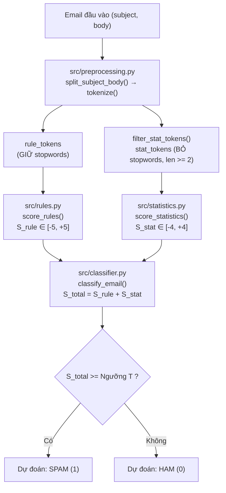

# Giải thích chi tiết các Hàm (`src/`) & Thuật toán trong dự án Email Spam Filter

> Tài liệu này tổng hợp đầy đủ **nguyên lý thuật toán**, **công thức toán học**, **mục đích từng hàm trong `src/`** và **cách xử lý các tình huống biên** — dùng làm tài liệu tra cứu cho cả 5 thành viên và làm cơ sở trình bày khi báo cáo / bảo vệ đồ án.

---

## 1. Sơ đồ tổng thể luồng thuật toán

---

## 2. Giải thích chi tiết 4 thuật toán cốt lõi

### 2.1. Thuật toán Tiền xử lý 2 nhánh Token (`src/preprocessing.py`)
- **Bài toán:** Nếu bỏ stopwords ngay từ đầu thì cụm từ nhiều chữ như `claim your prize` sẽ bị đứt thành `claim prize` và không khớp được quy tắc. Ngược lại, nếu giữ stopwords khi thống kê thì các từ phổ biến như `the`, `to`, `is`, `your` sẽ làm nhiễu bảng trọng số.
- **Giải pháp:** Từ cùng 1 bước tách từ `re.findall(r"[a-z0-9]+", text.lower())`, tách thành **2 nhánh**:
  1. **`rule_tokens` (giữ stopwords):** dùng cho `Rule Engine` để khớp chính xác cả từ đơn lẫn cụm nhiều từ.
  2. **`stat_tokens` (loại `STOPWORDS` cố định và token dài `< 2`):** dùng cho `Statistics Engine` để chỉ giữ các từ khóa mang nghĩa.
- **Xử lý tiền tố `Subject:`:** Trong bộ Kaggle Enron-Spam, 100% email mở đầu bằng `Subject: ...`. Hàm `split_subject_body()` cắt bỏ tiền tố `Subject:` ở dòng đầu để từ `"subject"` không làm nhiễu thống kê.

### 2.2. Thuật toán Chấm điểm Quy tắc — Rule-based Scoring (`src/rules.py`)
- **Nguyên lý:** Mỗi quy tắc trong `config/rules.json` có mẫu từ/cụm từ (`pattern`) và trọng số (`weight > 0` nếu là dấu hiệu Spam, `weight < 0` nếu là dấu hiệu Ham).
- **Cơ chế khớp ranh giới token (Token Sequence Matching):**
  - Chuyển `pattern` thành chuỗi token bằng `tokenize(pattern)` (ví dụ `"claim your prize"` → `["claim", "your", "prize"]`).
  - Duyệt cửa sổ trượt trên danh sách `tokens` của email để kiểm tra chuỗi con liền kề.
  - **Ưu điểm:** Không bao giờ khớp nhầm từ con (ví dụ `free` không khớp trong `freedom`, `win` không khớp trong `winner`).
- **Tính tối đa 1 lần / quy tắc / email:** Dù từ `free` lặp 10 lần (`free free free`), quy tắc `free` chỉ cộng điểm **1 lần** để tránh spam lặp từ phá vỡ thang điểm.
- **Chặn biên (Clipping):**
  $$S_{\text{rule}} = \text{clip}\left(\sum_{r \in \text{matched}} w_r, \; -5.0, \; +5.0\right)$$
  Dù tổng thô vượt quá `+5` hoặc `-5`, `S_rule` bị chặn trong `[-5, +5]` để không lấn át hoàn toàn điểm thống kê, nhưng danh sách `matched_rules` vẫn giữ đủ toàn bộ quy tắc đã khớp để giải thích cho người dùng.

### 2.3. Thuật toán Thống kê từ khóa — Keyword Statistics (`src/statistics.py`)
- **Lấy cảm hứng từ:** Tư tưởng log-odds của Bernoulli Naive Bayes nhưng được đơn giản hóa thành hệ thống chấm điểm có kiểm soát biên và dễ giải thích.
- **Giai đoạn 1 — Huấn luyện (`train_statistics`) CHỈ trên `data/train.csv`:**
  1. Đếm **Document Frequency** (theo cấp độ **email**, dùng `set(stat_tokens)`):
     - `df_s(w)`: số email Spam chứa từ `w` ít nhất 1 lần.
     - `df_h(w)`: số email Ham chứa từ `w` ít nhất 1 lần.
  2. Lọc bỏ từ hiếm: chỉ giữ các từ thỏa mãn $df_s(w) + df_h(w) \ge 3$ (tránh nhiễu từ lỗi chính tả hoặc từ chỉ xuất hiện 1–2 lần).
  3. Làm trơn Laplace (tránh chia cho 0 và tránh $\ln(0)$ khi một từ chỉ xuất hiện ở 1 lớp):
     $$P_s(w) = \frac{df_s(w) + 1}{N_s + 2}, \qquad P_h(w) = \frac{df_h(w) + 1}{N_h + 2}$$
  4. Tính trọng số log-ratio và chặn biên trong `[-2, +2]`:
     $$W(w) = \text{clip}\left(\ln\frac{P_s(w)}{P_h(w)}, \; -2.0, \; +2.0\right)$$
     - $W(w) > 0$: từ thiên về **Spam**.
     - $W(w) < 0$: từ thiên về **Ham**.
     - $W(w) \approx 0$: từ trung tính, xuất hiện tương đương ở cả 2 lớp.
- **Giai đoạn 2 — Chấm điểm email mới (`score_statistics`):**
  1. Lấy tập từ duy nhất trong `stat_tokens` có mặt trong bảng `weights` (từ chưa thấy trong train có trọng số `0`, không báo lỗi).
  2. Sắp xếp giảm dần theo độ mạnh $|W(w)|$; nếu hòa điểm thì sắp xếp phụ theo thứ tự bảng chữ cái `(-abs(w), token)` để **đảm bảo tính tái lập 100% (deterministic)**.
  3. Chọn tối đa **Top-5 từ mạnh nhất** (tránh email dài làm điểm phình to mất kiểm soát) và tính:
     $$S_{\text{stat}} = \frac{2}{5} \sum_{i=1}^{k} W(w_i) \in [-4.0, +4.0] \quad (k \le 5)$$

### 2.4. Thuật toán Phân loại Lai & Tối ưu Ngưỡng (`src/classifier.py` & Notebook 05)
- **3 chế độ phân loại:**
  - `rule_only`: dùng $S_{\text{rule}}$ so với ngưỡng $T_{\text{rule}}$.
  - `statistics_only`: dùng $S_{\text{stat}}$ so với ngưỡng $T_{\text{stat}}$.
  - `combined` (Hybrid): dùng $S_{\text{total}} = S_{\text{rule}} + S_{\text{stat}} \in [-9.0, +9.0]$ so với ngưỡng $T_{\text{combined}}$.
- **Quy tắc quyết định:** Nếu điểm $\ge T$ → dự đoán **`spam` (`1`)**, ngược lại → **`ham` (`0`)**.
- **Tối ưu ngưỡng trên Validation (chống Data Leakage):**
  - Quét lưới ngưỡng từ `-3.0` đến `+4.0` (bước `0.25`) chỉ trên `data/validation.csv`.
  - Chọn ngưỡng đạt **F1-score cao nhất** (ưu tiên phụ Accuracy), lưu cố định vào `config/settings.json`.
  - Áp ngưỡng cố định đúng 1 lần lên `data/test.csv` độc lập.
- **Lưu ý quan trọng:** Vì có bước chặn biên (`clip`) và chọn Top-5, mô hình này là **Additive Scoring phi tuyến nhẹ**, và điểm số $S_{\text{total}}$ **không phải xác suất % Spam**.

---

## 3. Danh mục chi tiết từng hàm trong `src/`

### 3.1. `src/models.py` — Kiểu dữ liệu & Hệ thống lỗi dùng chung
| Thành phần | Vai trò | Các trường / Ý nghĩa |
|---|---|---|
| `Email` | Đại diện 1 email chuẩn | `email_id`, `subject`, `body`, `label` (`spam`/`ham`/`None`), `source_group` |
| `RuleMatch` | Bằng chứng 1 quy tắc khớp | `rule_id`, `pattern`, `weight`, `description` |
| `KeywordEvidence` | Bằng chứng 1 từ khóa thống kê | `token`, `weight` |
| `ClassificationResult` | Kết quả phân loại chuẩn | `email_id`, `prediction`, `mode`, `rule_score`, `stat_score`, `total_score`, `threshold`, `matched_rules`, `top_keywords` |
| `SpamFilterError` | Lỗi gốc hệ thống | Gồm 3 lớp con: `DataLoadError` (lỗi đọc file/rỗng), `ConfigError` (lỗi JSON cấu hình), `ModelNotReadyError` (chưa có `keyword_stats.json`) |

### 3.2. `src/preprocessing.py` — Tiền xử lý & Đọc dữ liệu
| Hàm | Đầu vào | Đầu ra | Chức năng & Xử lý biên |
|---|---|---|---|
| `split_subject_body(raw_text)` | Chuỗi email thô | `(subject, body)` | Cắt tiền tố `Subject:` ở dòng đầu (không phân biệt hoa/thường); nếu không có thì `subject=""`. |
| `normalize_text(text)` | Chuỗi bất kỳ | `str` | Chuyển chữ thường, chỉ giữ token `[a-z0-9]+` nối bằng 1 dấu cách (dùng để khử trùng & kiểm tra leakage). |
| `tokenize(text)` | Chuỗi bất kỳ | `list[str]` | Tách danh sách token chữ thường theo ranh giới từ, **giữ stopwords** (dùng cho Rule Engine). |
| `filter_stat_tokens(tokens)` | `list[str]` | `list[str]` | Loại bỏ `STOPWORDS` cố định và token có `len < 2` (dùng cho Statistics Engine). |
| `prepare_email_tokens(email)` | `Email` | `(rule_tokens, stat_tokens)` | Ghép `subject + " " + body` rồi trả về đồng thời cả 2 nhánh token. |
| `load_email_from_txt(file_path, email_id)` | Đường dẫn `.txt` | `Email` | Đọc UTF-8, tách subject/body; báo `DataLoadError` tiếng Việt nếu thiếu file hoặc nội dung rỗng. |
| `load_emails_from_csv(file_path, require_label)` | Đường dẫn `.csv` | `(valid_emails, row_errors)` | Kiểm tra đủ cột bắt buộc; dòng lỗi riêng lẻ được ghi vào `row_errors` để không mất các dòng hợp lệ. |

### 3.3. `src/rules.py` — Rule Engine
| Hàm | Đầu vào | Đầu ra | Chức năng & Xử lý biên |
|---|---|---|---|
| `_has_token_sequence(tokens, pattern_tokens)` | 2 `list[str]` | `bool` | Kiểm tra chuỗi token liền kề của quy tắc có nằm trong email không (tránh khớp từ con). |
| `load_rules(config_path)` | Đường dẫn `rules.json` | `list[dict]` | Đọc và kiểm tra chặt schema (`id`, `pattern`, `weight != 0`, không trùng `id`); sai thì raise `ConfigError`. |
| `score_rules(tokens, rules, min_score=-5, max_score=5)` | `rule_tokens`, `rules` | `(rule_score, list[RuleMatch])` | Mỗi quy tắc cộng tối đa 1 lần, chặn tổng trong `[-5, +5]`, trả về đủ danh sách quy tắc khớp. |

### 3.4. `src/statistics.py` — Statistics Engine
| Hàm | Đầu vào | Đầu ra | Chức năng & Xử lý biên |
|---|---|---|---|
| `train_statistics(train_emails, min_df=3)` | `list[Email]` có nhãn | `dict` model | Đếm `df_spam`/`df_ham` theo cấp độ email, lọc `min_df`, làm trơn Laplace, log-ratio & clip `[-2, +2]`. |
| `save_statistics(model, output_path)` | `dict`, đường dẫn JSON | `str` đường dẫn | Tự tạo thư mục cha, lưu JSON UTF-8 `sort_keys=True`. |
| `load_statistics(model_path)` | Đường dẫn JSON | `dict` model | Đọc & kiểm tra khóa `weights`; thiếu hoặc hỏng sẽ raise `ModelNotReadyError` tiếng Việt. |
| `score_statistics(stat_tokens, model, top_k=5)` | `stat_tokens`, `model` | `(stat_score, list[KeywordEvidence])` | Bỏ qua từ chưa thấy (`0` điểm), chọn tối đa 5 từ có `|W|` lớn nhất (tie-break alphabet), tính `(2/5) * sum`. |
| `get_top_keywords_by_class(model, n=15)` | `model`, số lượng `n` | `(top_spam, top_ham)` | Trả về top `n` từ có trọng số dương lớn nhất (Spam) và âm nhất (Ham) để vẽ biểu đồ. |

### 3.5. `src/evaluation.py` — Đánh giá & Kiểm tra Data Leakage
| Hàm | Đầu vào | Đầu ra | Chức năng & Xử lý biên |
|---|---|---|---|
| `evaluate(y_true, y_pred)` | 2 `list[str]` | `dict` metrics | Quy ước `spam` là lớp dương; tính `tp, tn, fp, fn, accuracy, precision, recall, f1, fpr`. Chia cho 0 trả `0.0` kèm `warnings` tiếng Việt, không crash. |
| `evaluate_majority_baseline(train_labels, test_labels)` | Nhãn train & test | `dict` metrics | Mô hình cơ sở luôn đoán lớp phổ biến nhất trên train (hòa chọn `ham`) làm mốc so sánh. |
| `check_data_leakage(train, val, test)` | 3 `list[Email]` | `dict` báo cáo | Kiểm tra trùng `normalize_text(subject + body)` giữa 3 cặp tập `(train, val)`, `(train, test)`, `(val, test)`. |
| `export_evaluation_json(report, output_path)` | `dict`, đường dẫn | `str` đường dẫn | Xuất báo cáo đánh giá tổng hợp ra JSON UTF-8. |

### 3.6. `src/classifier.py` — Bộ phân loại Hybrid
| Hàm | Đầu vào | Đầu ra | Chức năng & Xử lý biên |
|---|---|---|---|
| `load_settings(settings_path)` | Đường dẫn `settings.json` | `dict` | Đọc và kiểm tra hợp lệ 3 ngưỡng `rule_only`, `statistics_only`, `combined`. |
| `save_settings(settings, settings_path)` | `dict`, đường dẫn | `str` | Lưu lại bộ ngưỡng sau khi tối ưu trên `validation.csv`. |
| `classify_email(email, mode, rules, stats_model, settings)` | `Email`, chế độ, model, cấu hình | `ClassificationResult` | Điều phối `prepare_email_tokens` → `score_rules` & `score_statistics` → tính `total_score` theo `mode` → so ngưỡng trả `spam`/`ham` kèm bằng chứng. Chặn email rỗng (`DataLoadError`) và thiếu model (`ModelNotReadyError`). |

### 3.7. `scripts/setup_data.py` — Khởi tạo & Xác thực dữ liệu tự động
| Hàm | Chức năng chính |
|---|---|
| `download_from_kaggle()` | Tải phiên bản cố định `venky73/spam-mails-dataset/versions/1` bằng `kagglehub`, tìm `spam_ham_dataset.csv` và copy atomic vào `data/raw/`. |
| `validate_raw_dataset()` | Kiểm tra đủ cột (`text, label, label_num`), từ chối bảng Bag-of-Words (> 50 cột), đúng 5.171 dòng, không NULL, khớp `label ↔ label_num` và khớp mã SHA-256 trong `data/manifest.json`. |
| `build_processed_datasets()` | Gọi `src/preprocessing.py` tách `subject`/`body`, tạo `clean_text` & `stat_text`, **khử trùng lặp trước khi chia**, chia stratified `seed=42` ra `train.csv` (350), `validation.csv` (75), `test.csv` (75), `unlabeled_sample.csv` (30) với **0 data leakage**. |
| `verify_processed_datasets()` | Xác thực lại toàn bộ file đầu ra về schema, phân bố lớp và không trùng lặp xuyên tập (dùng cho cờ `--verify`). |
| `run_setup()` | Điều phối toàn bộ quy trình idempotent (không tải lại/không ghi đè nếu dữ liệu đã hợp lệ, trừ khi có `--force`). |
