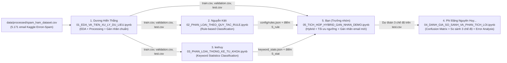

# Quy ước chung & Phân công nhiệm vụ (Jupyter Notebook `.ipynb`) — Phân loại Spam Email

> **Mục đích tài liệu:** Quy định thống nhất pipeline **EDA → Tiền xử lý & Đánh nhãn → Phân loại (Classification) → Đánh giá & Demo** bằng **Jupyter Notebook (`.ipynb`)** cho cả **5 thành viên**. Làm đúng theo file này giúp gộp 4 nhánh về `main` **không xung đột file, khớp 100% tên cột CSV/JSON và chạy nối tiếp trơn tru**.

---

## 1. Sơ đồ luồng xử lý & Mối liên hệ giữa 5 thành viên



---

## 2. Bảng phân công & Sở hữu file (Chống xung đột Git)

Mỗi thành viên làm trên **nhánh Git riêng** và **CHỈ tạo/sửa đúng các file của mình**:

| Thành viên | Nhánh Git bắt buộc | File Notebook chính (`.ipynb`) | File dữ liệu / kết quả sở hữu |
|---|---|---|---|
| **1. Dương Hiển Thắng** | `thang/eda-preprocessing` | `notebooks/01_EDA_VA_TIEN_XU_LY_DU_LIEU.ipynb` | `outputs/figures/eda_*.png`, `docs/data_description.md` *(chạy `setup_data.py` để sinh `train/val/test/unlabeled.csv`)* |
| **2. Nguyễn Kiệt** | `kiet/rule-classification` | `notebooks/02_PHAN_LOAI_THEO_QUY_TAC_RULE.ipynb` | `config/rules.json`, `outputs/rule_val_scores.csv`, `outputs/rule_test_scores.csv`, `outputs/figures/rule_*.png`, `docs/rule_specification.md` |
| **3. leehuy** | `leehuy/statistics-classification` | `notebooks/03_PHAN_LOAI_THONG_KE_TU_KHOA.ipynb` | `data/processed/keyword_stats.json`, `outputs/stat_val_scores.csv`, `outputs/stat_test_scores.csv`, `outputs/figures/stat_*.png`, `docs/statistics_method.md` |
| **4. Phí Đặng Nguyên Huy...** | `nguyenhuy/evaluation-qa` | `notebooks/04_DANH_GIA_SO_SANH_VA_PHAN_TICH_LOI.ipynb` | `outputs/evaluation_report.json`, `outputs/figures/eval_*.png`, `docs/test_report.md` |
| **5. Bạn *(Trưởng nhóm)*** | `main` / `lead/hybrid-integration` | `notebooks/05_TICH_HOP_HYBRID_GAN_NHAN_DEMO.ipynb`, `notebooks/06_TONG_HOP_TOAN_BO_DU_AN.ipynb` | `src/*`, `scripts/*`, `tests/*`, `config/settings.json`, `data/manifest.json`, `outputs/hybrid_*.csv`, `outputs/labeled_new_emails.csv`, `AGENTS.md`, `README.md`, `requirements.txt`, `.gitignore` |

---

## 3. Dataset Setup — Required Before Starting Tasks

Cả 5 thành viên chạy đúng các lệnh sau **ngay sau khi clone repo** (không cần tải CSV thủ công hay sửa đường dẫn):

```bash
git clone <repository-url>
cd <project-directory>

pip install -r requirements.txt

python scripts/setup_data.py
```

Để kiểm tra dữ liệu đã đầy đủ và hợp lệ trước khi chạy Notebook:

```bash
python scripts/setup_data.py --verify
```

Sau khi setup xong, mở Jupyter Notebook:

```bash
jupyter notebook
```

*(Hoặc mở trực tiếp file `.ipynb` bằng VS Code / Cursor / Antigravity với Python kernel đã cài `requirements.txt`.)*

---

## 4. Bản đồ Database / Dataset & Quy ước tên cột chuẩn

### 4.1. Nguồn dữ liệu gốc hiện có trong repo
- **Đường dẫn chính xác:** `data/processed/spam_ham_dataset.csv`
- **Số lượng:** **5.171 email** tiếng Anh (`ham`: **3.672**, `spam`: **1.499**).
- **Cột gốc:** `['', 'label', 'text', 'label_num']`
  - `label`: `"ham"` hoặc `"spam"`
  - `label_num`: `0` (ham) hoặc `1` (spam)
  - `text`: nội dung email gốc, dòng đầu mở bằng `Subject: <tiêu đề>`, các dòng sau là phần thân (`body`).

### 4.2. Quy ước cột chuẩn cho `data/train.csv`, `data/validation.csv`, `data/test.csv`
Tất cả 3 tập sau bước **Processing & Đánh nhãn** (do Dương Hiển Thắng xuất ra) bắt buộc có đúng **7 cột**:

| Tên cột | Kiểu dữ liệu | Ý nghĩa |
|---|---|---|
| `email_id` | `str` | Mã duy nhất (`E0001` → `E0500`) |
| `subject` | `str` | Tiêu đề email (tách từ dòng đầu `Subject:`) |
| `body` | `str` | Nội dung thân email đã làm sạch khoảng trắng thừa |
| `clean_text` | `str` | Văn bản đã chuẩn hóa chữ thường (`subject + " " + body` giữ stopwords, dùng cho Rule) |
| `stat_text` | `str` | Văn bản đã bỏ stopwords và token dài `< 2` (dùng cho Statistics) |
| `label` | `str` | Nhãn chữ chuẩn: `"spam"` hoặc `"ham"` |
| `label_num` | `int` | Nhãn số chuẩn: `1` (`spam`) hoặc `0` (`ham`) |

- **Chia tập cân bằng (stratified, `seed = 42`), khử trùng TRƯỚC khi chia:**
  - `data/train.csv`: **350 email** (175 `spam` / 175 `ham`)
  - `data/validation.csv`: **75 email** (38 `spam` / 37 `ham`)
  - `data/test.csv`: **75 email** (37 `spam` / 38 `ham`)
- **Tập chưa gán nhãn để demo đánh nhãn (`data/unlabeled_sample.csv`):**
  - Lấy **30 email khác** từ `spam_ham_dataset.csv` (không trùng với 500 email trên), bỏ cột `label`/`label_num` để Trưởng nhóm chạy pipeline **gán nhãn tự động** (`outputs/labeled_new_emails.csv`) và kiểm chứng lại!

### 4.3. Quy ước tiền xử lý dùng chung (bắt buộc giống nhau ở mọi notebook)
- **Tách token giữ stopwords (cho Rule):** `re.findall(r"[a-z0-9]+", text.lower())`
- **Danh sách `STOPWORDS` cố định (cho Statistics):**
  ```python
  STOPWORDS = frozenset({
      "a", "an", "and", "are", "as", "at", "be", "been", "being", "but", "by",
      "can", "could", "did", "do", "does", "for", "from", "had", "has", "have",
      "he", "her", "here", "hers", "him", "his", "how", "i", "if", "in", "into",
      "is", "it", "its", "just", "me", "more", "my", "no", "not", "of", "on",
      "or", "our", "out", "she", "should", "so", "some", "than", "that", "the",
      "their", "them", "then", "there", "these", "they", "this", "to", "too",
      "up", "us", "very", "was", "we", "were", "what", "when", "where", "which",
      "who", "why", "will", "with", "would", "you", "your", "yours",
  })
  ```
- **Lọc token thống kê:** bỏ token nằm trong `STOPWORDS` và token có `len(token) < 2`.

### 4.4. Quy ước cột CSV kết quả chấm điểm/dự đoán để ghép nối
- **File `outputs/rule_val_scores.csv` & `outputs/rule_test_scores.csv` (Nguyễn Kiệt):**
  `email_id,label,label_num,rule_score,matched_rules`
- **File `outputs/stat_val_scores.csv` & `outputs/stat_test_scores.csv` (leehuy):**
  `email_id,label,label_num,stat_score,top_keywords`
- **File `outputs/hybrid_test_predictions.csv` (Trưởng nhóm xuất cho Huy đánh giá):**
  `email_id,label,label_num,rule_score,stat_score,combined_score,pred_rule,pred_stat,pred_combined,matched_rules,top_keywords`

---

## 5. Quy tắc chống rò rỉ dữ liệu (Data Leakage) & Chuẩn học thuật

1. **Khử trùng lặp TRƯỚC khi chia** `train`/`validation`/`test`.
2. **Chỉ học từ `data/train.csv`:** Cả quy tắc (`rules.json`) lẫn bảng thống kê (`keyword_stats.json`) chỉ được xây từ `train.csv`.
3. **Chọn ngưỡng trên `data/validation.csv`:** Tối ưu 3 ngưỡng (`T_rule`, `T_stat`, `T_combined`) trên `validation.csv` rồi cố định.
4. **Đánh giá 1 lần trên `data/test.csv`:** Không sửa luật/ngưỡng sau khi đã xem kết quả Test.
5. **Không gọi điểm số là "xác suất %":** Điểm `S_rule ∈ [-5, +5]`, `S_stat ∈ [-4, +4]`, `S_total = S_rule + S_stat` là điểm phân loại có ngưỡng, không phải xác suất.
6. **Spam (`1`) là lớp dương (Positive)** trong toàn bộ Confusion Matrix và các công thức Precision, Recall, F1, FPR.

---

## 6. Hướng dẫn chi tiết xử lý toàn bộ các loại Tiền tố (Prefix)

Để cả nhóm xử lý nhất quán từ dữ liệu đến Git và tránh ghi đè file của nhau, mọi thành viên áp dụng đúng 4 nhóm tiền tố sau:

### 6.1. Tiền tố trong văn bản Email (`Subject:`, `Re:`, `Fwd:`, `FW:`)
- **Tiền tố `Subject:` ở dòng đầu cột `text` (trong `spam_ham_dataset.csv`):**
  - Đã được xử lý thống nhất bằng hàm `split_subject_body(raw_text)` trong `src/preprocessing.py`:
    - Nếu dòng đầu bắt đầu bằng `Subject:` (không phân biệt hoa/thường) → cắt bỏ tiền tố `Subject:` và lấy phần còn lại của dòng đó làm `subject`; các dòng tiếp theo làm `body`.
    - Nếu không có `Subject:` → `subject = ""` và toàn bộ nội dung là `body`.
  - **Không để dính chữ `subject` vào nội dung email** vì mọi email trong Enron-Spam đều mở đầu bằng `Subject:`, nếu không cắt bỏ thì từ `"subject"` sẽ xuất hiện ở 100% email làm nhiễu thống kê và biểu đồ EDA.
- **Tiền tố trả lời/chuyển tiếp (`Re:`, `Fwd:`, `FW:`):**
  - Trong `clean_text` (cho Rule Engine) có thể giữ nguyên hoặc chuẩn hóa theo `tokenize()` để không phá cụm từ.
  - Trong `stat_text` (cho Statistics Engine), các token 1 ký tự đã bị loại (`len < 2`), còn `"re"` / `"fw"` nếu xuất hiện nhiều trong Ham có thể được phân tích trong mục EDA để giải thích vì sao email nội bộ hay có `"re"`/`"fw"`.

### 6.2. Tiền tố mã định danh (ID Prefix) trong dữ liệu & cấu hình
| Tiền tố | Áp dụng cho | Ví dụ |
|---|---|---|
| `E` | Email có nhãn trong `train.csv` / `validation.csv` / `test.csv` (4 chữ số) | `E0001` → `E0500` |
| `U` | Email chưa có nhãn trong `unlabeled_sample.csv` (3 chữ số) | `U001` → `U030` |
| `R` | Mã quy tắc lọc từ khóa trong `config/rules.json` (3 chữ số) | `R001` → `R030` |

### 6.3. Tiền tố tên file biểu đồ (`outputs/figures/`) & kết quả (`outputs/`)
Mỗi thành viên dùng đúng tiền tố của mình để gộp nhánh **không bao giờ trùng tên file**:
- **Dương Hiển Thắng:** `outputs/figures/eda_*.png`
- **Nguyễn Kiệt:** `outputs/rule_*.csv`, `outputs/figures/rule_*.png`
- **leehuy:** `outputs/stat_*.csv`, `outputs/figures/stat_*.png`
- **Phí Đặng Nguyên Huy...:** `outputs/evaluation_report.json`, `outputs/figures/eval_*.png`
- **Trưởng nhóm:** `outputs/hybrid_*.csv`, `outputs/labeled_new_emails.csv`, `outputs/figures/hybrid_*.png`

### 6.4. Tiền tố nhánh Git & Commit Message
- **Tiền tố nhánh Git bắt buộc theo tên thành viên:**
  - `thang/...` (Dương Hiển Thắng) → `thang/eda-preprocessing`
  - `kiet/...` (Nguyễn Kiệt) → `kiet/rule-classification`
  - `leehuy/...` (leehuy) → `leehuy/statistics-classification`
  - `nguyenhuy/...` (Phí Đặng Nguyên Huy...) → `nguyenhuy/evaluation-qa`
  - `lead/...` (Trưởng nhóm) → `lead/hybrid-integration`
- **Tiền tố Commit Message (Conventional Commits):**
  - `feat(<tên>): ...` — Thêm notebook, biểu đồ, bộ quy tắc hoặc tính năng mới *(ví dụ: `feat(kiet): them 28 quy tac vao config/rules.json`)*
  - `fix(<tên>): ...` — Sửa lỗi code hoặc sửa sai biểu đồ/công thức
  - `docs(<tên>): ...` — Viết hoặc cập nhật báo cáo `.md`
  - `test(<tên>): ...` — Bổ sung hoặc cập nhật unit test
  - `chore(<tên>): ...` — Cập nhật cấu hình, `.gitignore`, `requirements.txt`
